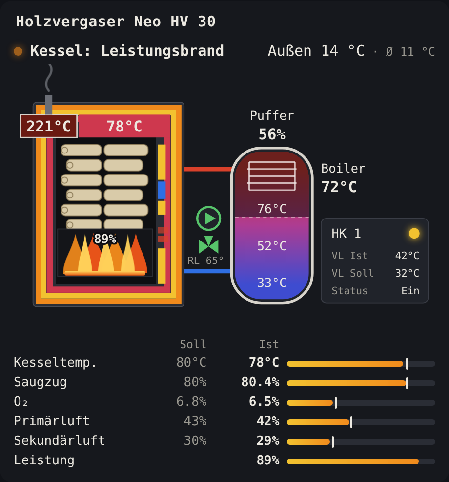

# Hargassner (lokal) für Home Assistant

Liest die Kesselsteuerung eines Hargassner Neo HV (getestet: Neo HV 30) lokal über
den Telnet-Datenstrom (Port 23) aus. Keine Cloud nötig.

## Installation

**HACS:** Repository als *Custom repository* (Typ *Integration*) hinzufügen, installieren, HA neu starten.

**Manuell:** `custom_components/hargassner` nach `/config/custom_components/hargassner` kopieren, HA neu starten.

Danach unter *Einstellungen → Geräte & Dienste → Integration hinzufügen → Hargassner (lokal)*
die IP des Kessels eintragen.

## Lovelace-Karte

Die Integration bringt eine Karte im Stil des Kesseldisplays mit: Kessel mit Brennraum
und Flammen, Puffer mit Temperaturverlauf, Boiler, Heizkreis 1 und Soll/Ist-Werte.
Sie wird automatisch geladen, eine Ressource muss nicht eingetragen werden.



Dashboard bearbeiten → *Karte hinzufügen* → „Hargassner Kessel“, oder per YAML:

```yaml
type: custom:hargassner-card
title: Holzvergaser    # optional
show_values: true      # optional, Soll/Ist-Tabelle
```

Die Sensoren werden über ihr Attribut `schluessel` gefunden, es ist keine Konfiguration nötig.

## Sensoren

Abgeglichen gegen den Cloud-Export (Stillstand und Abbrand) und gegen Displayfotos (Anheizen).

| Sensor | Feld | Status |
|---|---|---|
| Kesselzustand | 1 | geprüft (Display) |
| Sauerstoffgehalt Ist / Soll | 2 / 3 | geprüft |
| Kesseltemperatur Ist / Soll | 4 / 5 | geprüft |
| Rücklauftemperatur Ist / Soll | 6 / 7 | geprüft |
| Rauchgastemperatur | 8 | geprüft |
| Leistung | 9 | geprüft |
| Saugzug Soll / Ist (%) | 10 / 11 | geprüft (Display) |
| Puffer oben / Mitte / unten | 12 / 13 / 14 | geprüft |
| Puffer Füllgrad | 17 | geprüft |
| Primärluft Soll / Ist | 20 / 21 | geprüft (Display) |
| Sekundärluft Soll / Ist | 22 / 23 | geprüft (Display) |
| Saugzug Drehzahl | 26 | vermutet |
| Außentemperatur / gemittelt | 32 / 33 | geprüft |
| Höchste Anforderung | 34 | geprüft |
| Höchste Anforderung Puffer | 35 | geprüft (Feld 54 verhält sich fast gleich) |
| Puffer Solltemperatur / Ausschalttemperatur TPO | 41 / 42 | vermutet (Display 45 °C) |
| Vorlauf Ist HK 1 | 53 | geprüft |
| Vorlauf Soll HK 1 | 59 | vermutet |
| Boiler 1 | 76 | geprüft |

### Kesselzustand (Feld 1)

| Code | Klartext |
|---|---|
| 1 | Aus |
| 13 | Tür offen |
| 4 | Anheizen |
| 6 | Leistungsbrand |

Unbekannte Codes erscheinen als „Zustand N“. Der Zahlenwert steht im Attribut `code`.

Zusätzlich gibt es für jedes andere Feld einen deaktivierten Diagnose-Sensor
„Rohwert Feld N“. Damit lassen sich weitere Werte zuordnen.

## Optionen

- **Aktualisierungsintervall** (Standard 10 s): Der Kessel sendet etwa jede Sekunde.
  HA übernimmt höchstens alle N Sekunden einen neuen Wert, um die Datenbank zu schonen.

## Hinweise

Die Feldpositionen hängen von der Kessel-Firmware ab. Die Zuordnung wurde per
Cloud-Export abgeglichen (siehe `tests/test_parser.py`). Die Cloud speichert
alle 5 Minuten einen Momentwert vom Ende des Intervalls.
